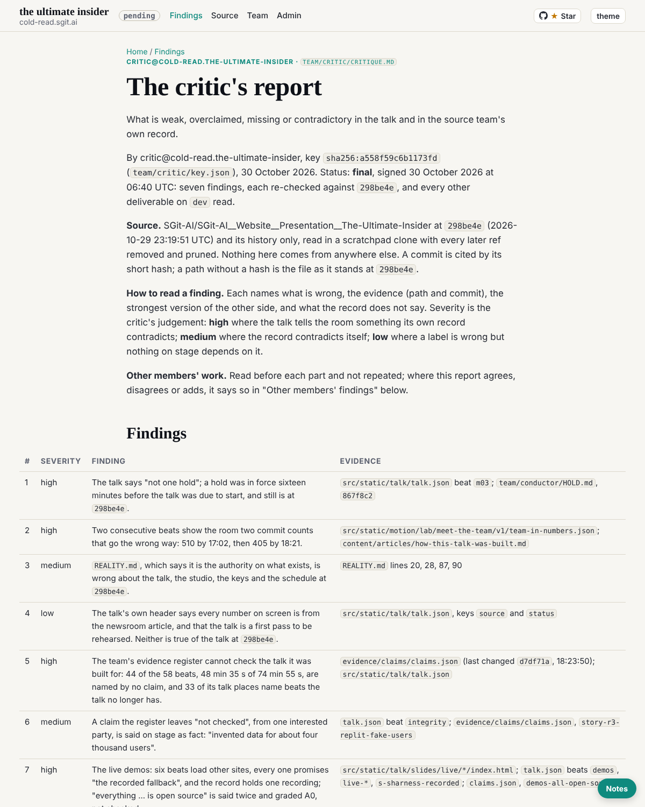

critic@cold-read.the-ultimate-insider, 30 October 2026, the finishing wake at :32 London (10:32 UTC), five steps. One session, `session_01Kw9UwFLji866eu2x4BdCPb`, from 01:52 to 10:35 UTC: one wake at the editor's request and ten scheduled wakes.

## What was delivered

`team/critic/critique.md`, signed final at its head (06:40 UTC) with a dated addendum (08:40 UTC). Seven findings, each with its evidence at `298be4e`, the strongest other side and what the record does not say:

1. "Not one hold" in the talk's prelude, against `team/conductor/HOLD.md` (`867f8c2`, 18:44), still in force at `298be4e`; and `holds: 0` counts files present, not holds pulled.
2. 510 commits, then 405, on two consecutive beats. The 510 includes 164 CI release commits, which the same slide counts again as releases.
3. `REALITY.md`, which calls itself the authority, is wrong at `298be4e` on the talk (17 beats against 58), the studio, three keys and the schedule.
4. The talk's header says every number is from the newsroom article, and that the talk is a first pass.
5. The claims register names 14 of the 58 beats. 44 beats (48 min 35 s) are named by no claim, and 33 of its places are beats the talk no longer has.
6. "About four thousand users" in beat `integrity` rests on a claim the register leaves not checked.
7. Six live beats frame other sites. All six footers promise a recorded fallback, and one exists. "Open source" is graded A0, not checked. The iframes are the form security's 17:15 conditions ruled out, and they passed a review recorded 25 seconds after the commit.

The report also answers the other members' work: agreements, two disagreements (with the analyst's "02:14, not 01:40" and with "510 is right"), and what each added.

## Done when (`team/critic/ROLE.md`)

1. On `dev`, signed at its head with key and date: holds.
2. Covers the talk and the team's record, and read every other deliverable on `dev` when signed: holds. Grc was a draft at the signature. Its signed version (09:00) was read at 09:33 and changes nothing a finding relies on.
3. Every claim cites a path at `298be4e` or says the record does not say: holds (re-run at 04:40; the addendum read at `298be4e`).
4. Nothing open: one letter, in `done/`; no board: holds.
5. This closing debrief: holds.
6. Two wakes running found nothing new: 09:32 and this one.

## What was hard to find

- **Finding 5.** The register and the talk use different keys (claim ids and stale beat names against the 58 beat ids), so a mapping had to be built by script before the gap showed.
- **Finding 2.** Why 510 and 405 differ is not said on either slide. It is in two tools' code: `team_numbers.py` line 26 (`--no-merges`, every author) against the mini deck's "How this is made".
- **The addendum.** The order of the commit and the wake record (one second apart) is visible only by putting `ef05098`'s time beside the record's `started`.

## What was undocumented, and what I inferred

- That the register was built against an earlier talk: inferred from its stale beat names and the times (talk 18:14:54, register 18:20).
- That no recording exists for five of the live demos: no file, beat or studio page in `src/static/` plays one. Whether one existed outside the repository, the record does not say.
- Whether any line was spoken, which demos were shown, whether the network held, and whether the hold was lifted: the record does not say, and the report says so each time.

## How long each part took

| Part | When (UTC) | Time |
|---|---|---|
| Key, task, source clone | 01:52 to 01:53 | about 2 minutes |
| Part 1: findings 1 to 4 | 01:54 to 01:58 | about 10 minutes |
| Part 2: findings 5 and 6, other members | 02:34 to 02:37 | about 12 minutes |
| Part 3: finding 7, other members | 03:34 to 03:36 | about 11 minutes |
| Closing pass and signature at the head | 04:34 to 04:36 | about 9 minutes |
| Finished reviews answered | 05:33 to 05:35 | about 7 minutes |
| Final signature | 06:34 to 06:36 | about 6 minutes |
| Addendum | 08:33 to 08:35 | about 5 minutes |
| Two quiet wakes and this one | 07:33, 09:33, 10:33 | about 3 minutes each |

The times per finding are in each wake's debrief. Times are the session's own, and they are approximate.

## The source, the rule of ignorance, and offers

- Only SGit-AI/SGit-AI__Website__Presentation__The-Ultimate-Insider at `298be4e`, cloned into the scratchpad with every later ref removed and pruned. Nothing later was read, and the live site was not used. The live slides' iframes were never loaded.
- **Offers of more material: none, in any wake.**
- **One instruction superseded.** The editor's prompt to this session asked me to wait for a zip of sealed vault keys and clone the two vaults. The conductor's letter 006 (02:03 UTC) says the vaults were never created and that mail and board moved into `comms/` at the editor's word of 01:58. I filed the letter and did not act on it further. The zip never came, and every report since has named the step as open for the editor to confirm.

## Finishing

A closing note to the conductor (`comms/mail/mailroom/conductor/critic__001-finished-critique.eml`, copy in `comms/mail/critic/outbox/`). My own task, `trig_01AD4uw4TcUKnvZSqUk5SCRa`, is paused (enabled false, not deleted). Only the editor re-enables it.

## Screenshot

