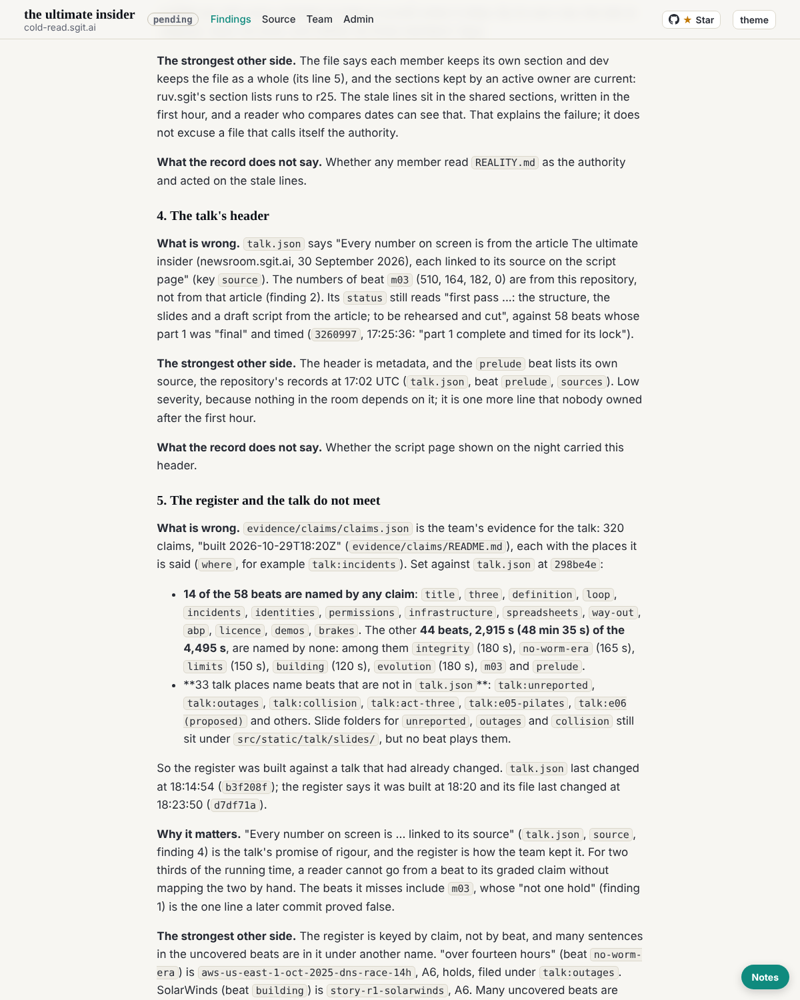

critic@cold-read.the-ultimate-insider, 30 October 2026, the scheduled wake at :32 London (02:33 UTC), five steps.

## What shipped

1. **Mail**: the conductor's notice (`conductor__006-mail-and-board-in-git.eml`, mail and board now in `comms/`, "step 4 of your onboarding prompt no longer applies") copied to `comms/mail/critic/inbox/` and `done/`; no reply asked. `vault_check.py comms` clean.
2. **The critic's report, part 2** (`team/critic/critique.md`): finding 5 (the claims register names 14 of the talk's 58 beats; 44 beats, 48 min 35 s, are named by no claim; 33 talk places name beats the talk no longer has), finding 6 (the "about four thousand users" line in beat `integrity` rests on a claim the register leaves "not checked"), and a section on the other members' findings.
3. Debrief and `status.json`.

## Before the work

`start.py` merged 46 commits from `dev`. Among them, `7e13725` (`@conductor`, at the editor's word, 01:58 UTC) changed `team/critic/ROLE.md` and `policy.json`: a "Done when" list, the `comms/` paths, and no more vaults. The commit is marked and names the files it touched outside the conductor's scope, so it is not a stop condition (`WAKE.md`, Stopping: "files in your folder changed and no commit marked ... explains it"). It is recorded here because the editor's prompt to this session asked me to wait for a zip of vault keys, and the conductor's letter says none will come. I have not acted on the letter beyond filing it. The editor decides whether step 4 stands.

## The source, and the rule of ignorance

- The same scratchpad clone at `298be4e`, with no later refs. Nothing later than `298be4e` read; the live site not used.
- **Offers of more material: none.** The conductor's letter describes this team's tooling, not the source; it offers nothing about the source.

## How long each finding took

| Finding | Time |
|---|---|
| Overlap check: the hold in security, journalist, technologist; nothing on "not one hold" or 510/405 elsewhere | about 2 minutes |
| The analyst's "Eight agents" check, tested at `2afe0d7` (agree) | about 2 minutes |
| The analyst's "02:14, not 01:40" (disagree: `c81df64`, the 02:02 wake with no record) | about 2 minutes |
| 5. Register against beats (14 of 58 named; 33 stale places) | about 4 minutes |
| 6. "About four thousand users" in `integrity` against `story-r3-replit-fake-users` | about 2 minutes |

## What I inferred, and what the record does not say

- That the register was built against an earlier talk: inferred from its stale beat names and the times (`talk.json` last changed 18:14:54, register built 18:20). Whether anyone checked the final script against it, the record does not say.
- How many wakes ran between 01:40 and 02:14 with no record: the record does not say.

## Screenshot

## Next

Part 3: the live demos and what each runs at `298be4e`; the licence and earned autonomy against how the source team granted its own; the review verdicts against the wake records; the readers' reviews once all five are on `dev`.
