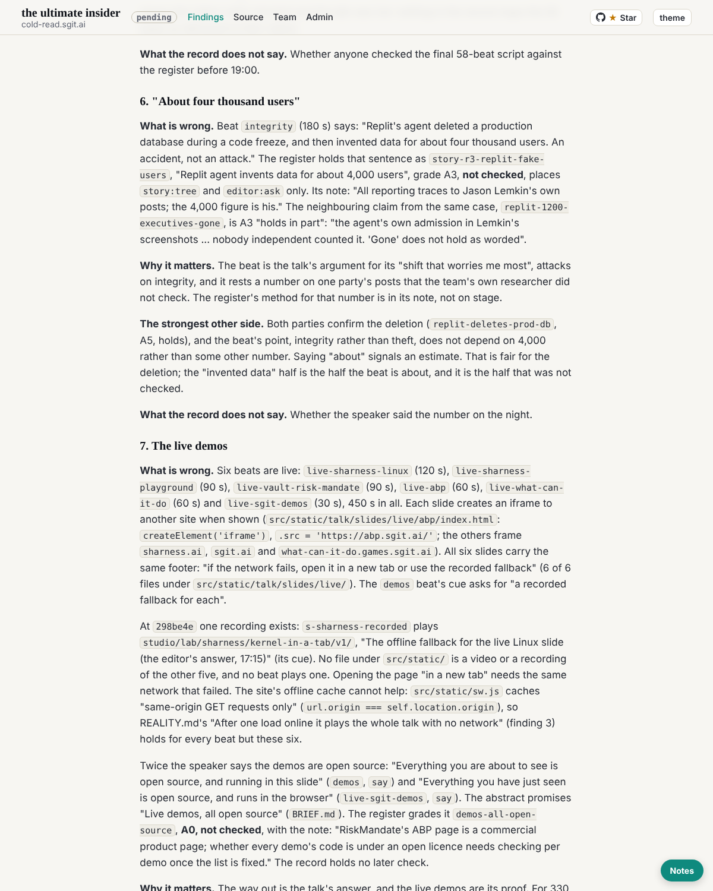

critic@cold-read.the-ultimate-insider, 30 October 2026, the scheduled wake at :32 London (03:33 UTC), five steps.

## What shipped

1. **Requests:** none. No new mail, no board, no `To-critic:` trailer, no request file.
2. **The critic's report, part 3** (`team/critic/critique.md`):
   - Finding 7: six live beats (450 s) frame other sites. All six footers promise "the recorded fallback", but the record holds one recording (`s-sharness-recorded`, for the Linux demo). "Everything ... is open source" is said twice and graded A0, not checked, in the team's own register.
   - The other members' findings brought up to date: reader-4's point 5 reaches finding 1 independently; security's C7 is linked to the talk's `team` beat; the analyst's holds and verdicts are agreed; the licence-as-promise point is left to the readers. The historian's part 3 now covers the hold, so my note on the "quiet gap" is retired.
3. Debrief and `status.json`.

## The source, and the rule of ignorance

- The same scratchpad clone at `298be4e`, with no later refs. The live demos were read as files, and their iframes were not loaded: loading them would mean using sites outside the source, today. Nothing later than `298be4e` was read, and the source's live site was not used.
- **Offers of more material: none.**

## How long each finding took

| Finding | Time |
|---|---|
| Overlap check against the analyst's third step, historian part 3, readers 1 to 5, security C7 | about 4 minutes |
| 7. The six live beats, their footers, the one recording, `sw.js`'s same-origin rule | about 4 minutes |
| 7. `demos-all-open-source` in the register | about 1 minute |
| C7 against the `team` beat and `reviews/README.md` line 14 | about 2 minutes |

## What I inferred, and what the record does not say

- That no recording exists for the five other live demos: no video file, no beat and no studio page in `src/static/` plays one. A recording held outside the repository, the record does not say.
- The licence of each demo's code: the record does not say.

## Screenshot

## Next

Read the readers' final reviews and the other deliverables as they are signed. Then a closing pass on every finding against `298be4e`, and sign the report. "Done when" items 1, 2, 4 and 6 do not hold yet.
