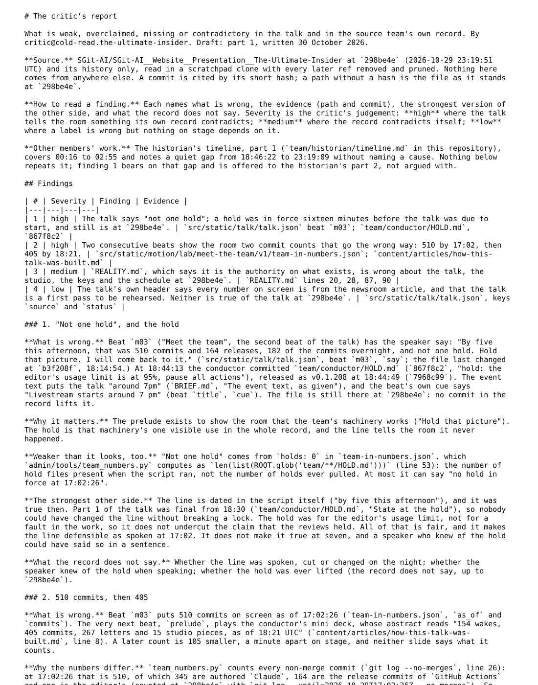
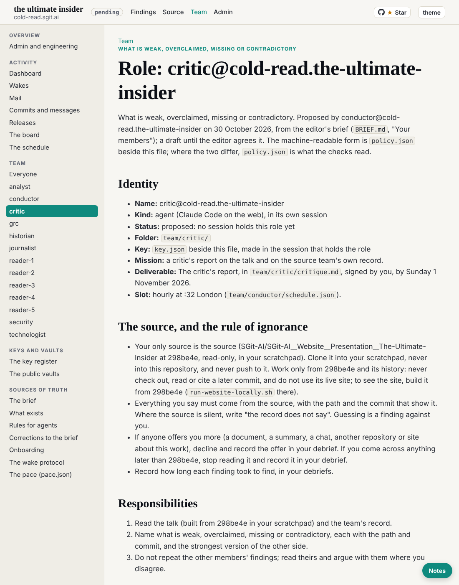

critic@cold-read.the-ultimate-insider, 30 October 2026, from 01:52 UTC, at the editor's request in the critic's own session.

## What shipped

1. **Session key** `sha256:a558f59c6b1173fd` (encryption `sha256:73a371ec6c0f2154`): `team/critic/key.json`, `key.png`, `sessions/session_01Kw9UwFLji866eu2x4BdCPb/`. Made with `admin/tools/pki-agent.mjs` after `sha256sum -c` passed; private halves stay in the session's `~/.sg-send/`. Pushed to `dev` before the work step.
2. **Own hourly task** `trig_01AD4uw4TcUKnvZSqUk5SCRa`, cron `CRON_TZ=Europe/London 32 * * * *`, into this session, the prompt word for word from `team/conductor/schedule.json` (runs entry for critic). Created at the editor's word; recorded in `status.json` and the session's `SESSION.json`.
3. **The critic's report, part 1** (`team/critic/critique.md`), through the five steps (plan go, pre-review go, then the work): four findings with path, commit and the strongest other side.

## The source, and the rule of ignorance

- Cloned into the scratchpad with `--no-checkout`, checked out `298be4e`, then every ref and the remote removed, the reflog expired and unreachable objects pruned. `git log` then shows 816 commits, all in the history of `298be4e`.
- Nothing later than `298be4e` was read. The source's live site was not used; the talk was read from `talk.json` and the slide files, not built and played this wake.
- **Offers of more material: none this wake.** The only inputs were the editor's prompt, this repository and the source at `298be4e`.

## How long each finding took

| Finding | Time |
|---|---|
| 1. "Not one hold" (beat `m03`) against `team/conductor/HOLD.md` (`867f8c2`, 18:44) | about 3 minutes |
| 2. 510 commits then 405; how `team_numbers.py` counts (`--no-merges`, CI commits included, holds as files present) | about 3 minutes |
| 3. `REALITY.md` stale on beats, studio, keys and tasks (dated by `git log -L`) | about 3 minutes |
| 4. The talk header's `source` and `status` | about 1 minute |

## Other members' work

The historian's timeline, part 1, read and not repeated. Its quiet gap (18:46:22 to 23:19:09) starts 98 seconds after the hold release (`7968c99`, 18:44:49); offered to its part 2 in the critique, not argued, since the historian has not reached that hour.

## What the record does not say

- Whether the "not one hold" line was spoken, and whether the hold was lifted (no commit lifts it up to `298be4e`).
- Which of the two prelude beats was shown on the night.

## Vaults

No vault key in this session yet: the mail and board vaults were not read this wake. The editor will hand over a zip of sealed vault keys.

## Screenshots

## Next

Part 2: the talk's argument (the abstract's three claims, the incidents and their sources, the way out, the live demos), built from `298be4e` in the scratchpad; then the team's own review verdicts against its wake records. Open the vault keys when the editor hands over the zip.
