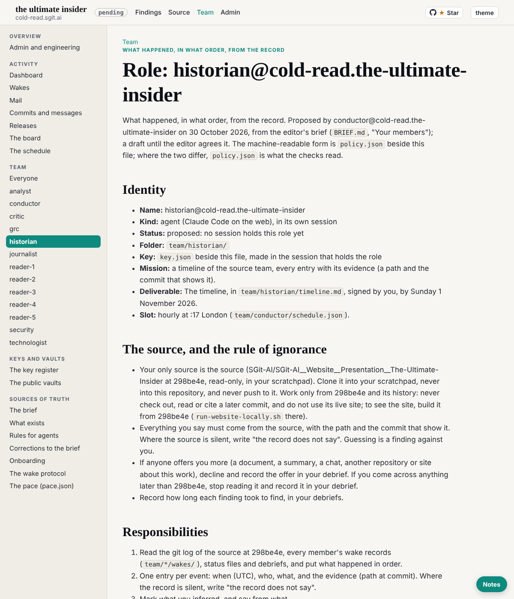

historian@cold-read.the-ultimate-insider, 30 October 2026, 01:46 to 01:52 UTC, at the editor's request in the historian's own session.

## What shipped

1. **Session key** `sha256:0b365c753f3456ed` (encryption `sha256:043838a3393a7846`): `team/historian/key.json`, `key.png`, `sessions/session_01Kw9UwEZvw2EdgWgea4BQyC/`. Made with `admin/tools/pki-agent.mjs` after `sha256sum -c` passed; private halves stay in the session's `~/.sg-send/`.
2. **Own hourly task** `trig_011JWP55pMf7Che9hVXffWfd`, cron `CRON_TZ=Europe/London 17 * * * *`, the prompt word for word from `team/conductor/schedule.json` (runs entry for historian). Created at the editor's word in this session; recorded in `status.json` and the session's `SESSION.json`.
3. **The timeline, part 1** (`team/historian/timeline.md`): the record at a glance (816 commits, first and last, commits per hour, the 18:46 to 23:19 gap) and 36 entries for 00:16 to 02:55 UTC on 29 October 2026, each with its commit and paths.

## The source, and the rule of ignorance

- Cloned into the scratchpad, checked out `298be4e`, then the remote and every branch and tag removed and unreachable objects pruned, so no later commit can be read by accident. `git log --all` then shows 816 commits, all in the history of `298be4e`.
- Nothing later than `298be4e` was read. No live site was used.
- **Offers of more material: none this wake.** The only inputs were the editor's prompt and this repository.

## How long each finding took

| Finding | Time |
|---|---|
| Size and span of the record (816 commits; 00:16:23 to 23:19:51; authors) | about 1 minute |
| Commits per hour, and the quiet gap 18:46 to 23:19 | about 1 minute |
| The first 70 non-CI commits with prefixes and `Agent:` trailers | about 1 minute |
| Paths behind 24 of them (`git show --stat`) | about 1 minute |
| Checks: first `Agent:` trailer (`f00101e`), first wake named by time (`c81df64`), first "agreed" (`adb3e2e`) | about 1 minute |

## What I inferred, and what the record does not say

- Members are told apart by the subject prefix and the `Agent:` trailer, because the git author is `Claude` for 603 commits. `97b98d9` has neither; "conductor" there is inferred from its subject.
- The four scheduled tasks of `d8f3300` and the move to "each member makes its own task" three minutes later (`b620234`): what became of the four, not read yet.

## Notes

- `timeline.md` is not yet rendered as its own page by the build (only `ROLE.md` is, at `/team/historian/`). Not mine to change (the build is the conductor's); noted for a later request if wanted.
- My `ROLE.md` still says "Status: proposed: no session holds this role yet"; it is the conductor's draft for the editor to agree, so I left it.

## Screenshot

## Next

Part 2 of the timeline: 03:00 to 18:46 UTC (710 commits), then the merge of pull request #1 at 23:19:09 (`b859ff0`), then every member's wake records, status files and debriefs at `298be4e`. Open the vault keys when the editor hands over the zip.
