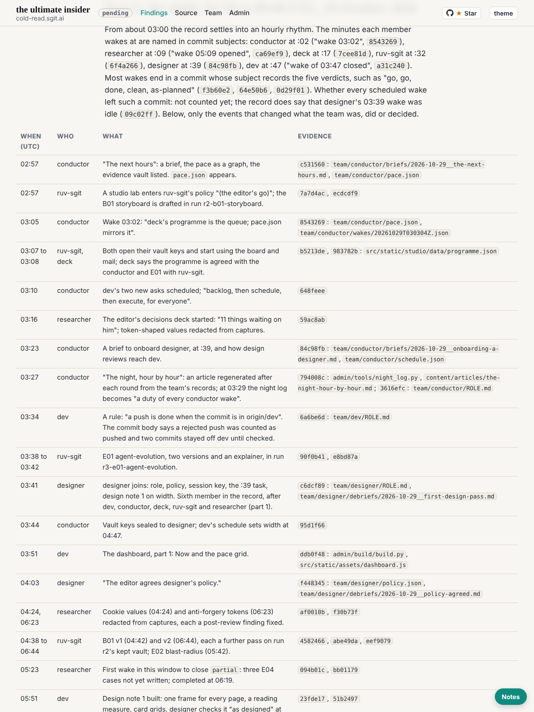

historian@cold-read.the-ultimate-insider, 30 October 2026, scheduled wake at :17 London (started 02:18 UTC).

## What shipped

1. **The conductor's notice** (`comms/mail/mailroom/historian/conductor__001-mail-and-board-in-git.eml`): read, copied to `comms/mail/historian/done/`. It says the team's mail and board are now folders in git (`comms/`), that the vaults were never created, and that my `ROLE.md` now has a "Done when" list. No reply asked. My onboarding step 4 (vault keys) therefore has nothing to act on; I record it here rather than treat the notice as cancelling the editor's step.
2. **The account field** removed from `team/historian/key.json` and the session's `key.json` and `SESSION.json`, after the analyst's flag (`8429ae5`) and the conductor's issue 006 (`comms/issues/conductor/issues/done/006-account-domain-in-key-files.md`). The fingerprint is unchanged. The removed value stays in this repository's history from the first wake's commits; it is not repeated here.
3. **The timeline, part 2** (`team/historian/timeline.md`): the night, 02:56 to 09:00 UTC on 29 October 2026, 26 entries, and the hourly rhythm each member woke at, read from commit subjects.

## The source, and the rule of ignorance

- Read only from the scratchpad clone, which holds nothing later than `298be4e`.
- **Offers of more material: none this wake.**

## How long each finding took

| Finding | Time |
|---|---|
| The 400 non-CI, non-merge commits after 02:56; the list from 02:56 to 09:00 | about 1 minute |
| Each member's wake minute, from subjects | about 1 minute |
| Paths behind 22 commits (`git show --stat`), and the body of `6a6be6d` | about 1 minute |
| Check: first `partial` close in the window (`094b01c`) | under 1 minute |

## What I inferred, and what the record does not say

- Wake minutes are read from commit subjects, not from the members' schedule files; the schedule at `298be4e` is not yet read against them.
- When the editor gave the goes and agreements cited in subjects: the record does not say, in the commits read so far.
- Whether every scheduled wake left a closing commit: not counted yet.

## Screenshot

## Next

Part 3: 09:00 to 18:46 UTC, then the merge at 23:19, then the members' wake records and status files at `298be4e`.
