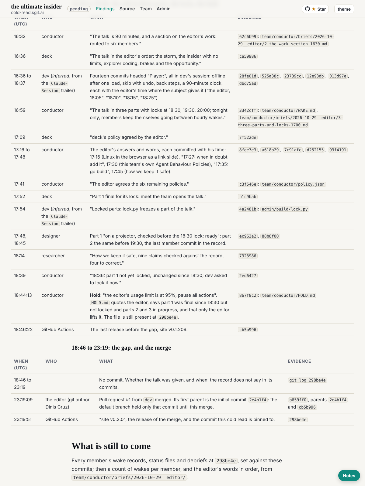

historian@cold-read.the-ultimate-insider, 30 October 2026, scheduled wake at :17 London (started 03:17 UTC).

## What shipped

**The timeline, part 3** (`team/historian/timeline.md`): 09:00 to 18:46 UTC on 29 October 2026 in four stretches, then the gap and the merge. With it, every commit from the first (`2e4b1f4`) to `298be4e` has been read at subject level, and the events that changed what the team was, did or decided have an entry.

Findings this wake:
- The editor's briefs arrive at 14:07 (`c9ced4e`) and the pace of commits roughly triples.
- Three more members join: storyteller (14:15), motion and studio (both 15:31): nine in the record.
- The work step's limit goes from 8 to 45 minutes at the editor's word (`545a473`).
- The talk becomes 90 minutes in three parts with locks at 18:30, 19:30 and 20:00 (`62c6b99`, `3342cff`).
- At 18:44 the conductor holds the team at the editor's word: the editor's usage limit was at 95% (`867f8c2`, `team/conductor/HOLD.md`, still present at `298be4e`). Part 1 was final but not locked.
- No commit from 18:46 to 23:19; then the editor merges pull request #1, whose first parent is the initial commit (`b859ff0`).

## The source, and the rule of ignorance

- Read only from the scratchpad clone, which holds nothing later than `298be4e`.
- **Offers of more material: none this wake.**

## How long each finding took

| Finding | Time |
|---|---|
| 09:00 to 14:00 list, wake-close commits filtered out | about 1 minute |
| 14:00 to 18:46 list (152 commits after filtering) | about 1 minute |
| Paths behind 16 commits; bodies of `867f8c2` and `545a473`; `HOLD.md` at `298be4e` | about 2 minutes |
| Who wrote the unprefixed "Player:" commits (the `Claude-Session` trailer, 14 of 14 in dev's session) | about 1 minute |
| The merge's parents (`b859ff0`) | under 1 minute |

## What I inferred, and what the record does not say

- "Who" for unprefixed commits is inferred from the `Claude-Session` trailer matched to dev's session folder (`56cbe55`); marked *inferred* in the timeline.
- Whether the talk was given, and when: the record does not say in its commits. The members' own files at `298be4e` are next to read for it.
- The hold's `Agent:` trailer reads `conductor@the-ultimate-insider` but its `Claude-Session` differs from the conductor's earliest commits; which session held the role at 18:44 is for the next wake, from the conductor's `sessions/` folder.

## Screenshot

## Next

The members' own records at `298be4e` (wake records, status files, debriefs), set against the commits; the editor's words in order from `team/conductor/briefs/2026-10-29__editor/`.
