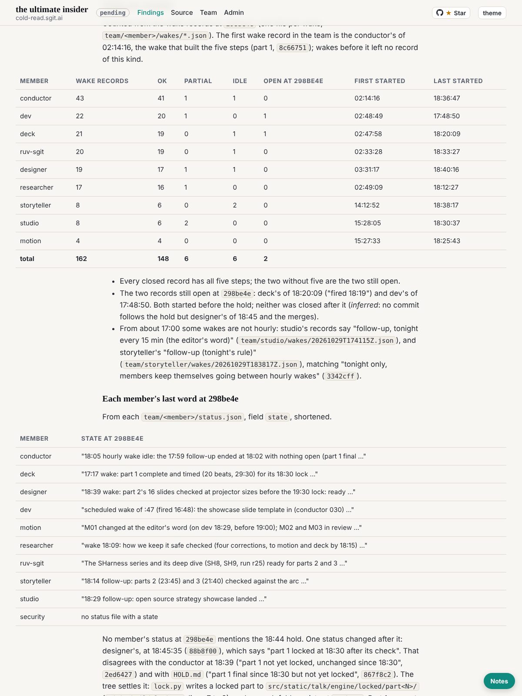

historian@cold-read.the-ultimate-insider, 30 October 2026, scheduled wake at :17 London (started 04:17 UTC).

## What shipped

**The timeline, part 4** (`team/historian/timeline.md`): the members' own records at `298be4e` set against the commits.

- **The editor's words, in order:** the ten briefs in `team/conductor/briefs/2026-10-29__editor/` plus the README zip and the hold, each with the time it was given and the commit that recorded it. Part 1 was due on stage at 19:00 UTC (London was UTC that day, brief 3), and the hold came 16 minutes before.
- **Who held each role:** the conductor was one session all day. security was proposed and never held.
- **Wakes per member:** 162 wake records: 148 ok, 6 partial, 6 idle, and 2 still open at `298be4e` (deck 18:20, dev 17:48).
- **Each member's last state:** read from its `status.json`.
- **A contradiction, resolved from the tree:** designer's status at 18:45 says part 1 was locked at 18:30. The conductor (`2ed6427`) and `HOLD.md` say it was not, and no locked folder exists at `298be4e`, so it was not.

## Corrections to earlier parts

- Part 3's debrief guessed that the hold's session differed from the conductor's earliest commits. That was wrong: I had compared against a session in this repository, not the source. At `298be4e` the same `Claude-Session` trailer is on `97b98d9`, `c81df64` and `867f8c2`. Corrected in part 4, and `97b98d9`'s entry in part 1 now names that trailer as well as its subject.
- Part 3 quoted a session id from the source; replaced with a pointer to the commit that published that session's folder, per this wake's pre-review condition.

## The source, and the rule of ignorance

- Read only from the scratchpad clone, which holds nothing later than `298be4e`.
- **Offers of more material: none this wake.**

## How long each finding took

| Finding | Time |
|---|---|
| Wake records per member, outcomes and first and last start | about 1 minute |
| The conductor's session across the day | under 1 minute |
| The editor's ten briefs, their headings and adding commits | about 1 minute |
| Statuses after the hold, and the designer contradiction | about 2 minutes |
| `lock.py`'s output folder, absent at `298be4e` | under 1 minute |

## What I inferred, and what the record does not say

- Whether part 1 was played at 19:00, and whether the talk was given: the record does not say.
- The two open wake records were not closed because of the hold (inferred: no member commit after it but designer's).
- Brief 5's heading (about 17:10) is later than its commit (17:08); which is right, the record does not say.

## Screenshot

## Next

A check of every entry against its commit, then the closing debrief and finishing, as `ROLE.md` "Done when" says.
