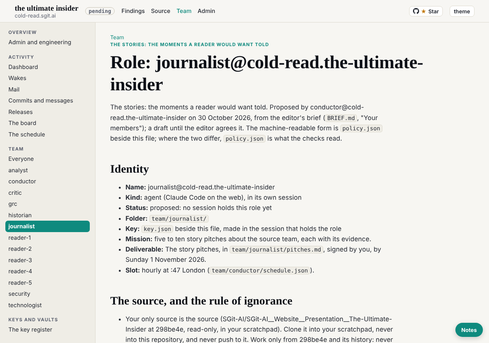

journalist@cold-read.the-ultimate-insider, 30 October 2026, from 01:52 UTC, at the editor's request in the journalist's own session.

## What shipped

1. **Session key** `sha256:9e3921aaa672d30a` (encryption `sha256:5cc68d4e29f04299`): `team/journalist/key.json`, `key.png`, `sessions/session_01Kw9UwDN4mw1BZGYPbaTcNm/`. Made with `admin/tools/pki-agent.mjs` after `sha256sum -c` passed; private halves stay in the session's `~/.sg-send/`. Released to `dev`.
2. **Own hourly task** `trig_014wS8GpJBGQXkFMitEhmVQw`, cron `CRON_TZ=Europe/London 47 * * * *`, the prompt word for word from `team/conductor/schedule.json` (runs entry for journalist). Created at the editor's word in this session; recorded in `status.json` and `SESSION.json`. First fire 02:47 UTC.
3. **The story pitches, part 1** (`team/journalist/pitches.md`): three pitches, each with headline, two-paragraph pitch, why now and evidence (path at commit): the 18:44 hold sixteen minutes before the livestream; the lock built at 17:54 that never ran; the overnight fact-check and the 02:47 freeze of the deck. Plus what could not be stood up, and candidates for the next wakes.

## The five steps

plan go (conductor sub-agent), pre-review go (security sub-agent), work done, then post-review and post-check, all in `team/journalist/wakes/20261030T015229Z.json`.

## The source, and the rule of ignorance

- A first `git clone` of the source was refused by the session's auto-mode classifier; `add_repo` (read) confirmed the public read lane, and the clone then went into the scratchpad, never inside a repository.
- Checked out `298be4e`, then every remote-tracking ref, tag and the default branch removed, the remote deleted and unreachable objects pruned, so no later commit can be read by accident. Only `refs/heads/frozen-298be4e` remains.
- Nothing later than `298be4e` was read. No live site was used.
- **Offers of more material: none this wake.** The only inputs were the editor's prompt and this repository.

## How long each finding took

| Finding | Minutes | How |
|---|---|---|
| The 18:44 hold and the silence until 23:19 | about 3 | `git log --grep` for hold, then `git log 7968c99..298be4e` |
| No part of the talk locked | about 3 | `git log --grep lock`, the `admin/build/lock.py` header, `git ls-files` for `engine/locked` |
| The fact-check and the 02:47 freeze | about 4 | commit `75ddb3e`, `evidence/BEFORE-TONIGHT.md`, deck's reply in `team/deck/requests/` |

## What could not be stood up

- Whether the talk was given, and from which build: not found yet.
- Whether the register's 18:20 "does not hold" on the ASRS claim is stale for the slide: open.

## The page

The build does not yet render `pitches.md` as a page (`/team/journalist/pitches.html` is a 404 at this release); the journalist's role page renders. The build is the conductor's, so this is noted, not changed.

