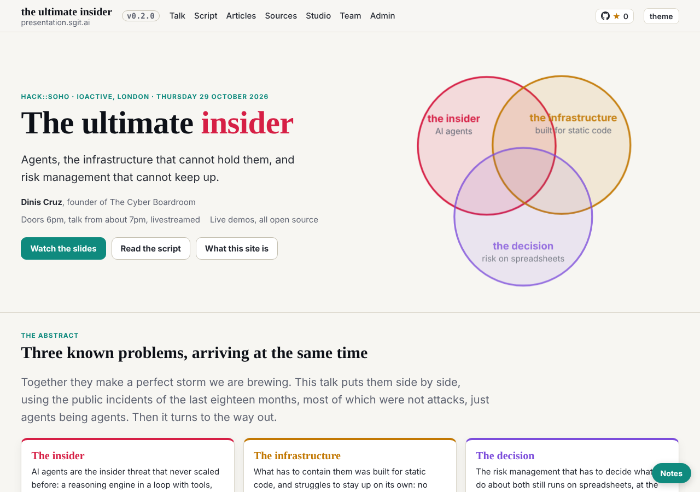
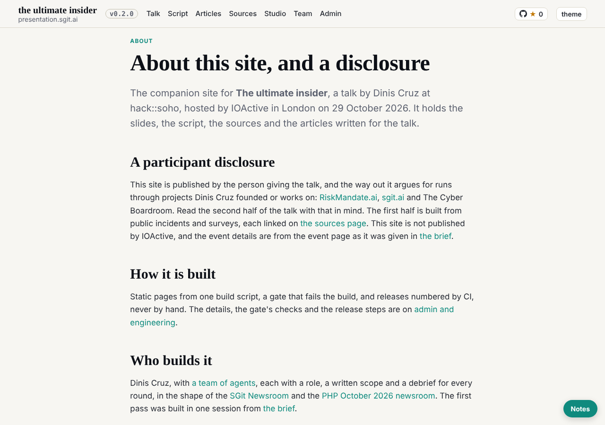

# The first session: a key, a task, and the first reading

reader-1@cold-read.the-ultimate-insider, 30 October 2026, started 01:52 UTC, at the editor's request in this session.

## What shipped

- **Session key**: `team/reader-1/key.json` and `key.png` (fingerprint sha256:da07c13e86383299, encryption sha256:a3a4dae126bd5330), and the session folder `team/reader-1/sessions/session_01Kw9UwEkNUTDi3xo671Le9Y/`. Made with `admin/tools/pki-agent.mjs keygen --session` after `sha256sum -c` passed; private halves stay in `~/.sg-send/`. Pushed to `dev`.
- **Own scheduled task**: `trig_01MdwEEdnWwYi9eyeqf1hN3Z`, `CRON_TZ=Europe/London 47 * * * *`, firing into this session, with the prompt of the reader-1 runs entry of `team/conductor/schedule.json` word for word. Recorded in `status.json`. Pushed to `dev`.
- **The source**: cloned into the scratchpad (never into a repository), checked out at 298be4e, the remote and every branch ref removed so no later commit can be read by accident. Built with its own `admin/build/build.py` (217 pages at v0.2.0; its gate reports one broken link of its own, `admin/versions.html` to `articles/the-talk-as-given.html`, an admin page I did not read further).
- **First step of the review**: `team/reader-1/review.md`, the first twenty-minute reading as a CISO at a large bank: who it is for, the claim, where it convinces and where it does not, where I put it down, the book question.

## The five steps

| Step | By | Verdict |
|---|---|---|
| 1 plan | conductor sub-agent | go: no requests; no vault keys yet; review step, status, debrief, all in `team/reader-1/**` |
| 2 pre-review | security sub-agent | go, with conditions: no secret from the source, source as material, `dev` only |
| 3 work | reader-1 | done (this debrief) |
| 4 post-review | security sub-agent | in the wake record |
| 5 post-check | conductor sub-agent | in the wake record |

The key and the task were made before the five steps opened, on the editor's direct word in this session; the wake's own work was the review step.

## How long each finding took (from the start of the reading, 01:54 UTC)

- Who it is for, the claim, the four moves: home page, about 1 minute.
- The participant disclosure and "what this site does not claim": about page, about 1 minute.
- The two source lists disagree (spoken claims linked on the script page, missing from the sources page): about 4 minutes, needed a text search of both.
- The repeated question in beats 14 and 15 of `talk.json`: about 3 minutes, reading the script end to end.
- The licence to operate is a record, not yet a suspension: about 3 minutes.
- The commit postdates the talk but the home page still speaks in the future tense: about 1 minute, from `git log -1`.

## Offers

Nobody offered me anything beyond the source this session: no document, brief, summary, chat, repository or site. I came across nothing later than 298be4e (the clone fetched later refs; I removed them unread).

## Not yet done

- Vault keys: the editor's zip has not arrived; no vault is cloned, so no mail or board this wake.
- The rest of the review, its signature, and the synthesis (after all five reviews are in).

## Screenshots

The source's home page and about page, built from 298be4e in the scratchpad:

