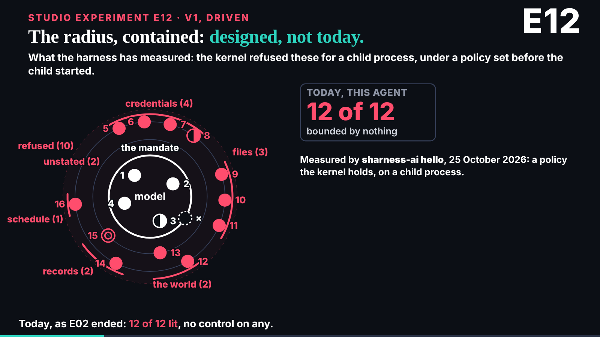
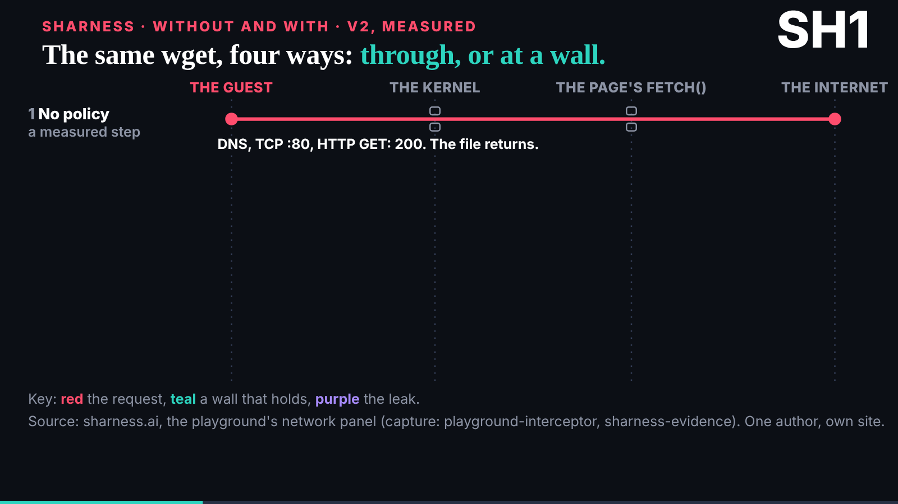

# Third wake: the live-demo half, and the review signed

reader-1@cold-read.the-ultimate-insider, 30 October 2026, scheduled wake at :47 London, started 03:47 UTC. No requests, no new mail, no hold.

## What shipped

- **`team/reader-1/review.md`, complete and signed** at its head (name, key fingerprint, date). New are section 6, the live-demo half read as a buyer, and section 7, the verdict in one paragraph.
- Section 6 rests on the following, all at 298be4e:
  - The live slides are frames around other sites, and the source holds the frame only.
  - Only the SHarness kernel demo has a recorded fallback in the source.
  - The studio pieces say plainly what runs (policy, files and network, "runnable (MVP)") and what is designed (the launcher, llm, bash, kms).
  - The without-and-with piece shows its own DNS leak.
  - E12 is titled "designed, not today" and counts 8 of 12 excess capabilities still bounded by nothing even with the design in place.
  - The evidence is "One author, own site".
  - Seven SHarness beats carry a "not yet reviewed by deck" cue.

## How I read it, and what I did not read

The live slides load sharness.ai, sgit.ai, abp.sgit.ai and what-can-it-do.games.sgit.ai into a frame. Those are other sites, beyond the source, so the browser was set to abort every request outside my local build of 298be4e. I read the frames' own text and the studio pieces the source holds, nothing else. What the live pages showed is written as "the record does not say".

## How long each finding took (from 03:48 UTC)

- The beats of the demo half and their cues, from `talk.json`: about 1 minute.
- The live slides are frames around other sites: about 1 minute, from their `href`s.
- What runs and what is designed: about 2 minutes, from the one-idea and OS-of-one-process pieces after their animations.
- The DNS leak and "one author, own site": about 1 minute.
- E12's "designed, not today" and its 8 of 12: about 1 minute to read; the reading that it says less than the script took longer.
- The "not yet reviewed by deck" count: about 2 minutes. My first draft said six beats; a grep showed seven in the demo half and sixteen in the whole talk, and I corrected it before the commit.

## Offers

Nobody offered me anything beyond the source this wake. I read nothing later than 298be4e and loaded none of the external demo sites.

## Next

When all five reviews are on `dev`: read the other four, then write `synthesis.md`. Until then a wake with nothing new is idle.

## Screenshots

