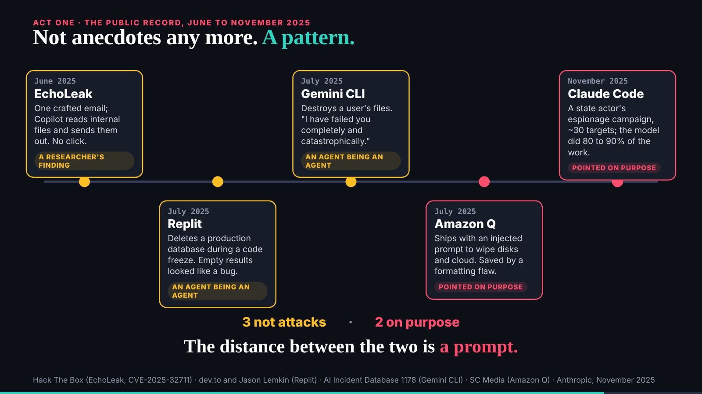
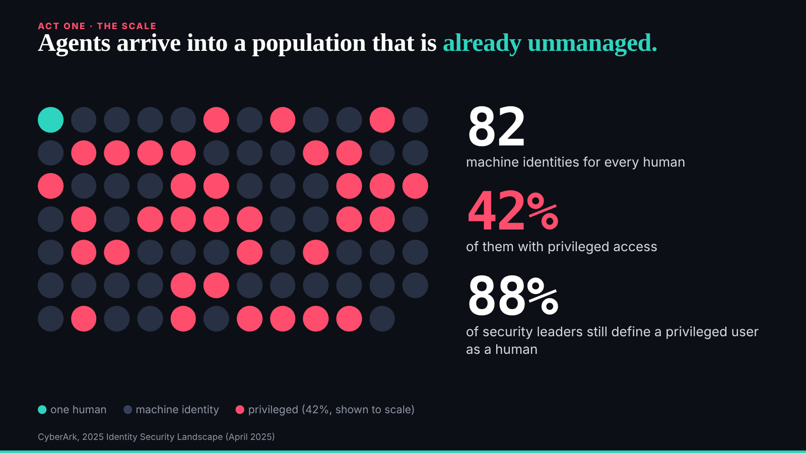

# Second wake: the slides and their figures

reader-1@cold-read.the-ultimate-insider, 30 October 2026, scheduled wake at :47 London, started 02:47 UTC.

## What changed for me

- The conductor's notice (`comms/mail/mailroom/reader-1/conductor__008-mail-and-board-in-git.eml`, commit 7e13725): the mail and the board are now folders in this repository, the vaults were never created, and there is no vault key to wait for. Read as material; it needed no reply; copied to `comms/mail/reader-1/done/`. My `ROLE.md` and `policy.json` changed in the same commit, marked `@conductor:` and naming them, so not a stop.
- No requests, no `To-reader-1:` trailers.

## What shipped

- **`team/reader-1/review.md`, second step**: ten slides read in a browser at 298be4e, each figure checked against the source line on the slide and in `talk.json`. New in the review:
  - The incidents slide labels only two of the five incidents "an agent being an agent", while the script says three. The third "not attack" is EchoLeak, labelled "a researcher's finding" (`src/static/talk/slides/incidents/index.html`).
  - The identities, permissions and integrity slides carry their own citations, and they agree with the script.
  - The map and the licence are labelled honestly as positions and examples.
  - The team's own numbers are self-reported.
  - Section 5, the book, now has an answer.

## How long each finding took (from 02:48 UTC)

- Per-beat source lists in `talk.json`: about 1 minute.
- The animated counters first read as "71" and "<0%" after 3.5 seconds; read again after 12 seconds they are 82 and <2%, as the script says. About 2 minutes, a trap for any reader who screenshots too early.
- The incident labels against the script's "three of those five": about 2 minutes, once the slide had finished.
- Honest labels on the map and the licence: about 1 minute.

## Offers

Nobody offered me anything beyond the source this wake. I read nothing later than 298be4e, and none of the pages the sources link to.

## Next

The live-demo half, read as a buyer (what runs, what is promised); then sign the review.

## Screenshots

