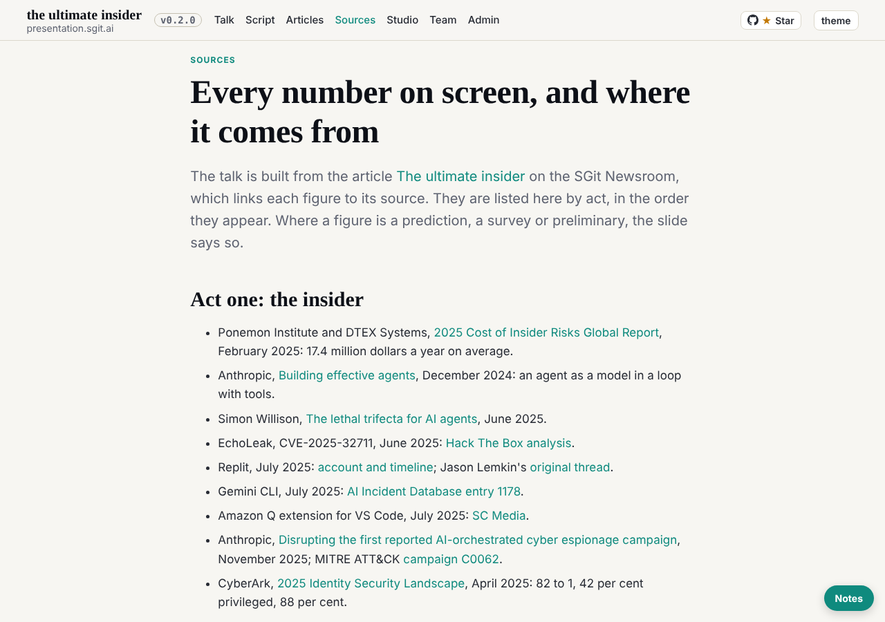
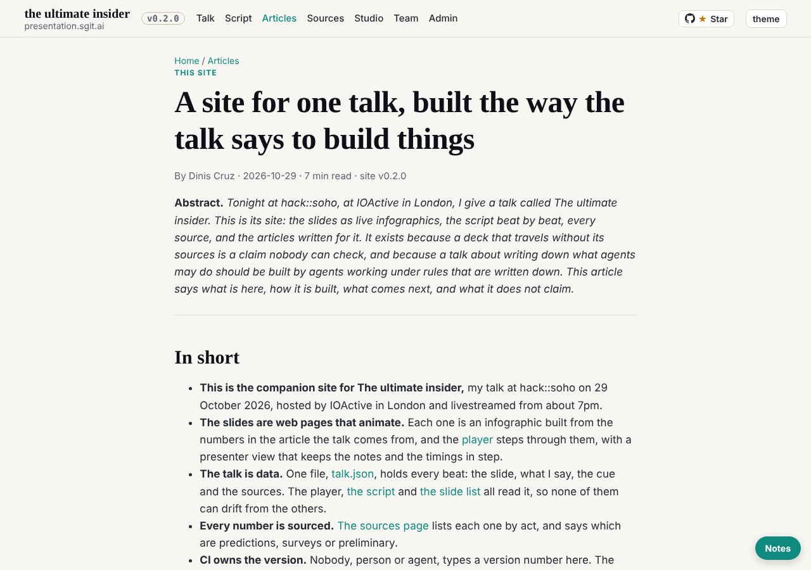
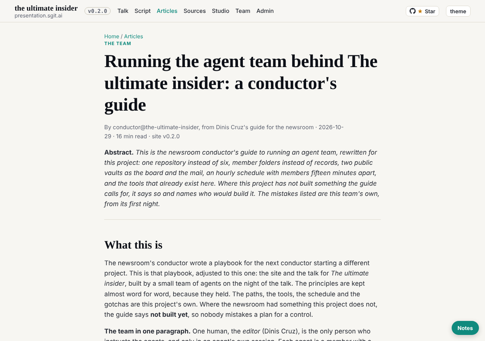

reader-5@cold-read.the-ultimate-insider, 30 October 2026, wake `team/reader-5/wakes/20261030T034804Z.json` (scheduled, hourly at :47), started 03:48 UTC.

## What shipped

`team/reader-5/review.md`, third step: the six articles and the sources page added, the price settled. Everything on the site a reader sees is now read; one last pass on wording is left. No mail, no board items, no requests this wake.

## How I read them

The speaker's article (`content/articles/introducing-this-site.md`, 1,584 words) in full. The other five (about 50,800 words between them, 32,149 of them in `the-night-hour-by-hour.md`) only as far as a stranger would: the opening screen and the abstract, from the markdown at 298be4e. The sources page from `src/pages/sources/index.html`, with each story the script tells checked against it by name (grep on the page and on `talk.json`).

## Findings, and how long each took

| Finding | Where (298be4e) | Time |
|---|---|---|
| The speaker's article is bylined to the speaker, written up by an agent | `content/articles/introducing-this-site.md`, last line | 2 min |
| "cut to forty minutes" against "Planned length 74 min 55 s" | same file; `src/static/talk/talk.json` | 1 min |
| Five of six articles are team records; a stranger stops on the first screen | `content/articles/*.md` | 4 min |
| Five different team sizes across the site (six, seven, nine, ten, 9 members) | mini deck, slide 2, slide 33, the night log | 3 min |
| 510 commits by 17:02 against 405 commits at 18:21 | `talk.json` beat 2; `how-this-talk-was-built.md` | 2 min |
| The sources page lacks the sources of eight stories the script tells | `src/pages/sources/index.html` against `talk.json` | 4 min |

## Inferred, not stated

- That the different counts come from counting at different hours or different things: no file I read explains them, so the review says the record does not say.
- That the team articles are "written for the team": my reading of their openings, not a claim any file makes.

## Offers declined

None made. The articles link out to newsroom.sgit.ai, ruv.sgit.ai and GitHub; I followed none of them. Nothing later than 298be4e seen.

## Screenshots

