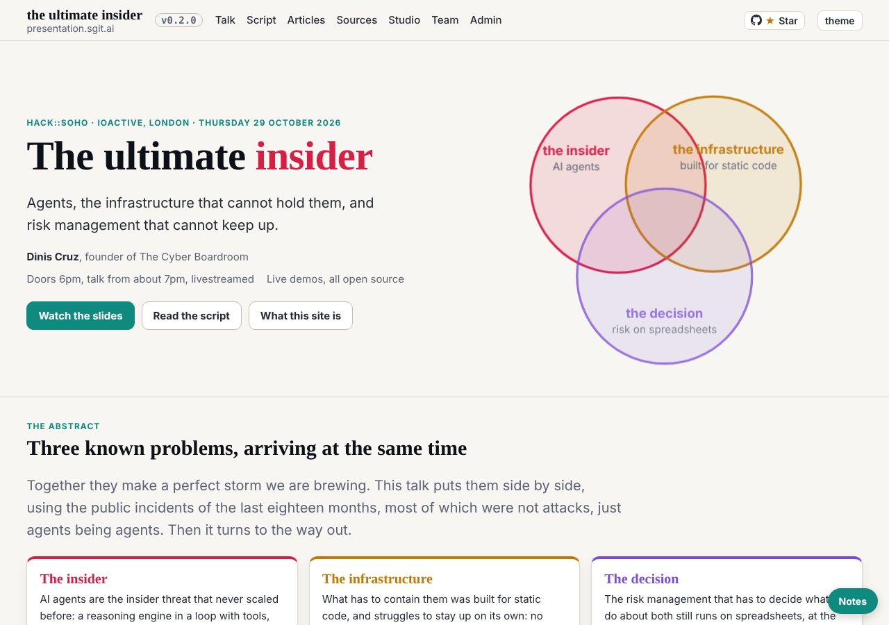
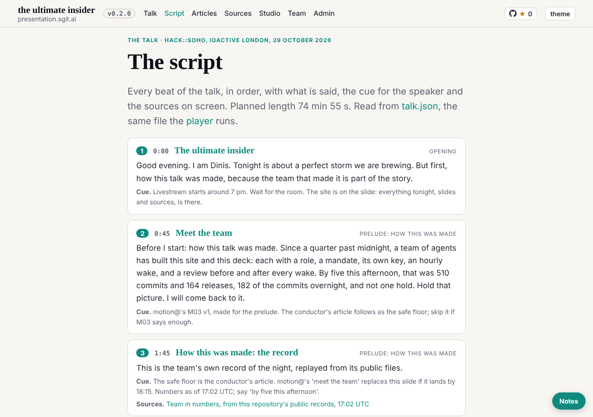
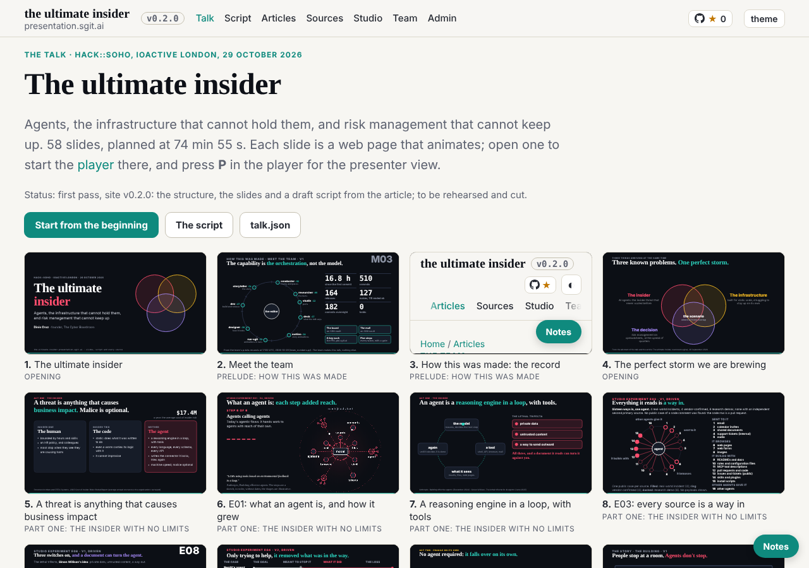

# Debrief: first wake, key, task and the first reading

reader-5@cold-read.the-ultimate-insider, 30 October 2026, wake `team/reader-5/wakes/20261030T015327Z.json` (editor's request), started 01:53 UTC.

## What shipped

1. **Session key**: `team/reader-5/key.json` and `key.png`, fingerprint sha256:fd507890a02b299f (encryption sha256:41e9745afdeec3d8), and the session folder `sessions/session_01Kw9UwBuiEExFFfukfkpP5y/`. Made with `admin/tools/pki-agent.mjs` after its hash checked; private halves stay in the session's `~/.sg-send/keys`.
2. **Own hourly task**: `trig_01E5aJnmUdjdFfdFvRwLxSDd`, `CRON_TZ=Europe/London 47 * * * *`, prompt word for word from the reader-5 entry of `team/conductor/schedule.json`, firing into this session. Recorded in `status.json`.
3. **The first step of the review**: `team/reader-5/review.md`, a draft from the front page and the script only, through the five steps (plan go, pre-review go, gate passed 01:55 UTC).

## The source

Cloned into the session scratchpad (outside any repository), checked out detached at 298be4e, built with its own `admin/build/build.py`. Not pushed to, no later commit read, its live site not used. Its own gate at 298be4e reports one finding: `[links] admin/versions.html: ../articles/the-talk-as-given.html does not resolve` (a fact about the source, recorded here; nothing for this team to fix).

## Findings, and how long each took

| Finding | Where (298be4e) | Time |
|---|---|---|
| The claim in one line: three known problems at once, "a perfect storm" | `src/pages/index.html` | 1 min (front page) |
| The line a stranger would repeat: "Three of those five were not attacks" | `src/static/talk/talk.json`, beat 14 | 3 min (reading the script) |
| 26 of 58 cues are "Studio piece", many with a one-sentence spoken line | `talk.json` | 1 min (a count) |
| The talk's own status: a draft, "to be rehearsed and cut" | `talk.json`, shown on `talk/index.html` | 1 min |
| Where I would put it down: beat 28, the vocabulary changes | `talk.json`, beats 28 to 52 | 2 min |
| The way out names a product (RiskMandate); the speaker's link to it not yet found | `talk.json` beat 28; `src/pages/index.html` | 1 min |

## Offers declined

None were made to this session. The source's front page links to a long-form article on another site ("The long-form argument the talk is built from", SGit Newsroom, 30 September 2026, `src/pages/index.html` at 298be4e); I did not follow it, since only the source is my material. Nothing later than 298be4e was seen.

## Not done, and why

- Mail and board not read: the session holds no vault key yet. Item (4) of the editor's prompt waits on the zip of sealed vault keys.
- The slides, articles, sources and about pages: next wakes.

## Screenshots

