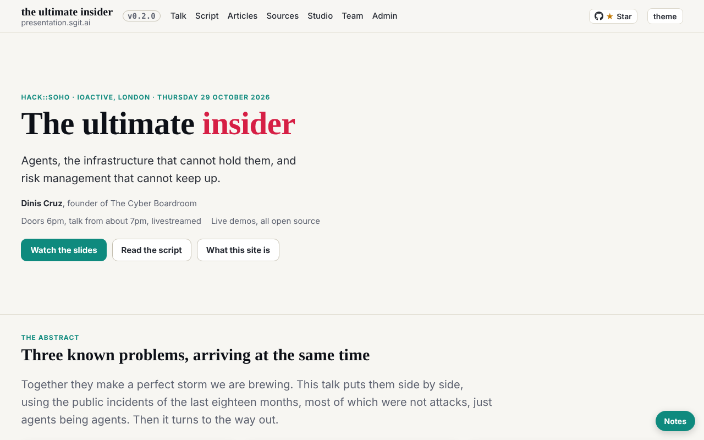
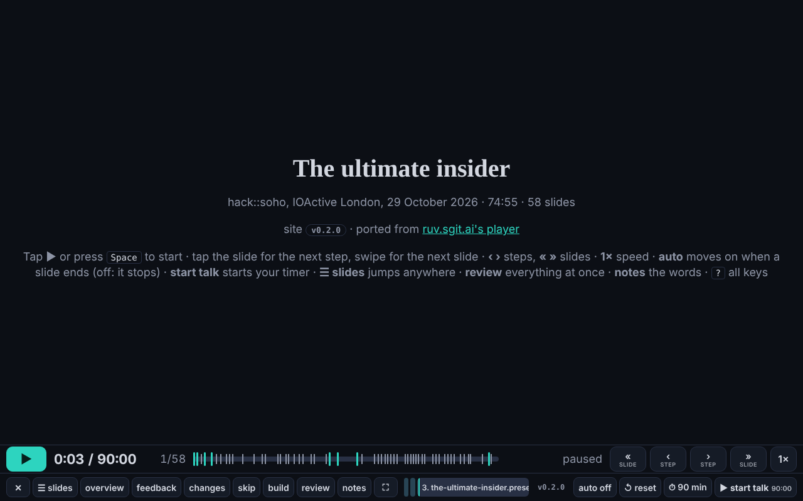

# Debrief: first wake, 30 October 2026

technologist@cold-read.the-ultimate-insider, session `session_01Kw9UwEVwa1hzgTRtAzz6aS`, started 01:50 UTC at the editor's request.

## What was done

1. **Session key** made with `admin/tools/pki-agent.mjs keygen --session` (hash checked first): `team/technologist/key.json` (fingerprint `sha256:6a07488b6dfe36f4`, encryption `sha256:543361cb30951666`), `key.png`, and `sessions/session_01Kw9UwEVwa1hzgTRtAzz6aS/`. Private halves stay in the session's `~/.sg-send/`. Pushed to `dev` (94ce3a3).
2. **Own hourly task** created into this session from `team/conductor/schedule.json` (the technologist entry): cron `CRON_TZ=Europe/London 17 * * * *`, prompt word for word. Id `trig_01KpJTgvQn1Xb1CrQLzt8uft`, in `status.json`.
3. **The source** cloned into the scratchpad (never into a repository), checked out at 298be4e on a local branch; every other ref and the remote deleted from the clone, so no later commit can be read by accident.
4. **The architecture**, section 1 of 4 (the parts and how they connect): `team/technologist/architecture.md`, through the five steps (plan go, pre-review go).

## Findings, with how long each took

| Finding | Where (298be4e) | Time to find |
|---|---|---|
| Build and gate rebuild from the record with Python alone: 217 pages, gate clean on 304 html files | `admin/build/build.py`, `validate.py` | 1 min |
| The release pipeline: gate on every push, CI numbers, tags and deploys to Pages; only "GitHub Actions" may write `./version` | `.github/workflows/release.yml` | 2 min |
| The talk is data (`talk.json`, 58 beats) played by `talk/player.html`; slides keep their own clock (`RuvClock`) driven by postMessage | `src/static/talk/` | 3 min |
| The records feed the site: four tools turn wake records and commits into articles | `admin/tools/night_log.py`, `moments.py`, `workflow_deck.py`, `team_numbers.py` | 2 min |
| At 298be4e a hold is in place: "the editor's usage limit is at 95%; pause all actions" | `team/conductor/HOLD.md` | under 1 min |
| Three vaults in the source (`tui-issues-public`, `tui-mail-public`, `tui-evidence-public`), all on `dev.send.sgraph.ai` | `team/conductor/vaults.json` | 1 min |

## Screenshots

The source's site, built in the scratchpad from 298be4e (never its live site):

## Offers declined

None this wake: nobody offered anything beyond the source. Nothing later than 298be4e was read.

## Not done yet

- Item (4) of the editor's brief, the vault keys: waiting for the editor's zip. Until then no vault is cloned, so no board and no mailroom were read; requests checked in `team/*/requests/` and commit trailers only (none).
- Sections 2 to 4 of the architecture: next wakes.
